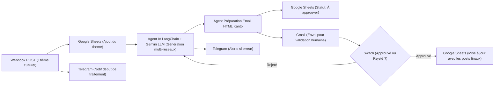

# Kanto MG — Workflow n8n : Automatisation Éditoriale & Réseaux Sociaux

Ce dossier contient le workflow d'automatisation **n8n** conçu pour générer, structurer, faire relire et archiver les contenus culturels multi-plateformes de **Kanto MG**.

Le workflow est directement importable dans n8n via le fichier [`creation-contenus-kanto.json`](./creation-contenus-kanto.json).

---

## 1. Vue d'ensemble du flux



---

## 2. Piliers Culturels & Règles Éditoriales Kanto MG

Le workflow est calibré selon les directives de [`MARKETING.md`](../../MARKETING.md) et la charte de marque de Kanto :

* **Devise** : `KANTO — Lova • Kolontsaina • Tantara` (Héritage • Culture • Histoire).
* **Les 4 piliers** :
  1. **Angano** (Contes oraux, leçons de vie, récits et créatures traditionnelles).
  2. **Kabary** (Art oratoire solennel, rhétorique rituelle, respect des aînés et *Fihavanana*).
  3. **Tantara** (Chroniques royales, figures historiques, repères patrimoniaux).
  4. **Lalao & Ohabolana** (Proverbes malgaches, devinettes *Ankamantatra*, vocabulaire rare *Raki-teny*).
* **Bilinguisme Malgache / Français** : Chaque publication contient une phrase, proverbe ou expression en malgache avec sa traduction française exacte.
* **Sobriété et dignité** : Zéro spam d'emojis criards (pas de 🚀🔥🎉), respect de la sacralité culturelle, palette officielle (Vert Tanimbary `#4A6741`, Ocre doré `#C58B38`, Parchemin `#F5F4F0`).

---

## 3. Plateformes couvertes par l'IA

| Réseau Social | Format & Angle éditorial | Spécificités Kanto |
| :--- | :--- | :--- |
| **LinkedIn** | Professionnel, transmission, leadership culturel | Analyse du *Fihavanana*, préservation du patrimoine |
| **Instagram** | Visuel immersif, poétique, carrousel ou énigme | Suggestion visuelle palette Tanimbary, phrase bilingue |
| **Facebook** | Récit communautaire et intergénérationnel | Invitation au débat et aux variantes régionales |
| **X (Twitter)** | Synthétique, percutant (max 280 caractères) | Proverbe du jour ou repère historique + traduction |
| **TikTok** | Script vidéo dynamique (15 à 60 secondes) | Énigme *Ankamantatra* ou 'Le savais-tu ?' sur Madagascar |
| **Threads** | Conversationnel, nuance linguistique | Débat sur une expression ou tradition malgache |
| **YouTube Shorts** | Mini-format éducatif (< 60 secondes) | Titre accrocheur, storyboard et liens in-app |

---

## 4. Guide d'importation dans n8n

### Étape 1 : Importer le workflow
1. Ouvrir votre instance n8n (ex: `https://n8n.votre-domaine.com` ou local).
2. Cliquer sur **Workflows** puis **Import from File...**.
3. Sélectionner le fichier [`creation-contenus-kanto.json`](./creation-contenus-kanto.json).

### Étape 2 : Configurer les identifiants (*Credentials*)
Dans l'interface n8n, relier vos comptes aux nœuds correspondants :
* **Google Gemini LLM** (`googlePalmApi` / `googleGeminiApi`) : Votre clé API Gemini (Google AI Studio).
* **Gmail de Récapitulation** (`gmailOAuth2`) : Compte Gmail utilisé pour l'envoi de l'email de relecture.
* **Nœuds Google Sheets** (`googleSheetsOAuth2Api`) : Votre compte Google avec accès à la feuille de suivi.
* **Nœuds Telegram** (`telegramApi`) : Token du bot Telegram de notification.
* **Nœud Webhook** (`httpBasicAuth`) : Identifiants sécurisés (login/mot de passe) pour déclencher le workflow.

---

## 5. Déclenchement via Webhook

Pour lancer la génération d'un ensemble de contenus culturels, envoyer une requête HTTP POST :

```bash
curl -X POST "https://n8n.votre-domaine.com/webhook/contenue-2d53-4d1d-a14c-dc4412e82d15" \
  -u "utilisateur:motdepasse" \
  -H "Content-Type: application/json" \
  -d '{
    "message": "Le conte d'\''Ikotofetsy sy Imahaka et la leçon sur la ruse et l'\''honnêteté"
  }'
```

Le workflow effectuera ensuite :
1. L'enregistrement du thème dans le tableur de suivi.
2. La notification sur votre canal Telegram.
3. La génération par IA des 7 publications selon la charte Kanto.
4. L'envoi par email d'une prévisualisation HTML avec boutons d'approbation.
5. La mise à jour de la feuille Google Sheets une fois validé.
